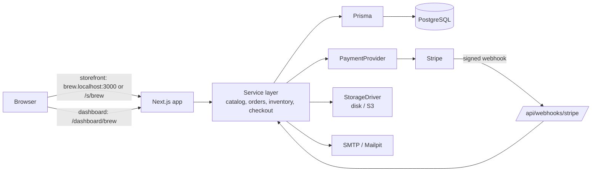
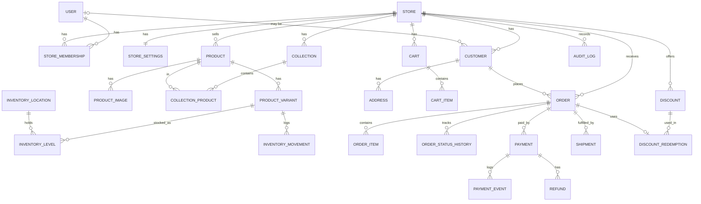

# Phase 0 — Discovery & Design

Multi-tenant, multi-store e-commerce platform. Portfolio-first, low-cost, built in reviewable phases.

Status: **proposal, awaiting approval.** Nothing has been built yet. The project folder was empty when this was written.

---

## 1. MVP scope

The MVP is "Phases 1–4": a working platform where two demo merchants run visibly different stores, a customer can buy in Stripe test mode, and the merchant can fulfil the order.

### In the MVP

| Area | Included |
|---|---|
| Accounts | Email + password sign-up, email verification, password reset, sessions, sign-out |
| Platform admin | List merchants/stores, suspend/unsuspend a store |
| Stores | Create store (setup wizard), branding (logo, colours), currency, contact details, publish/unpublish, launch checklist |
| Staff | Invite by email, roles: Owner, Manager, Inventory Editor, Fulfilment Agent |
| Catalog | Products, variants (size/colour), SKUs, images, price, compare-at price, draft/published, SEO title/description, collections |
| Storefront | Home, collection pages, product page, search, filter (collection, price, in-stock), sort, cart, mobile nav |
| Checkout | Guest or signed-in, server-calculated totals, coupon codes, demo tax and shipping rules, Stripe Checkout (test mode) |
| Orders | Lifecycle with recorded history, fulfilment + tracking number, cancel, refund via Stripe |
| Inventory | Single location per store, movement ledger, low-stock alerts, oversell protection via reservations |
| Customers | Order history, address book |
| Dashboard | Sales, orders, average order value, top products, low stock, recent activity, CSV export of orders |
| Email | Order confirmation, shipping notification, staff invite, verify email, reset password |
| Audit | Audit log of sensitive merchant actions |

### Deliberately later (Phase 7 or beyond)

Custom domains, Stripe Connect payouts to merchants, subscriptions/merchant billing, bulk CSV import, multi-location inventory, carrier integrations, themes, multilingual, marketplace-wide search, admin MFA *(MFA moves to Phase 5 hardening — it is in scope, just not first)*.

### Demo-ready vs production-ready

This is the honest line. The README will repeat it.

| Capability | Demo-ready (what we will build) | Needed before real merchants |
|---|---|---|
| Payments | Stripe **test mode** on one platform account, clearly labelled | Stripe Connect (each merchant gets their own connected account), merchant identity verification, terms of service, refund/chargeback policy |
| Tax | Flat percentage per region, labelled "demo, not tax advice" | A real tax service (e.g. Stripe Tax) and jurisdiction review |
| Shipping | Flat rate / free-over-threshold per store | Carrier rates, address validation |
| Email | Dev inbox (Mailpit) locally, one SMTP provider in staging | Domain authentication (SPF/DKIM/DMARC), bounce handling |
| Uploads | Local disk in dev, S3-compatible bucket in staging | Malware scanning, CDN, lifecycle rules |
| Ops | Health endpoint, structured logs, one backup + restore rehearsal | Monitoring with alerts, on-call, tested disaster recovery, legal privacy policy |

---

## 2. Recommended stack

| Concern | Choice | Why | Alternatives considered |
|---|---|---|---|
| Language | **TypeScript (strict)** | One language front and back; types catch tenant/ID mix-ups early | — |
| Framework | **Next.js (App Router)** | Server components and server actions keep data access on the server; one deployable app | Remix/React Router, separate Express API + React SPA (more moving parts) |
| Database | **PostgreSQL** | Relational data, transactions for inventory, runs everywhere (Docker, Azure, Neon, RDS) | MySQL |
| ORM | **Prisma** | Readable schema file, generated types, migration history — easiest for a beginner to read | Drizzle (closer to SQL, lighter; good second choice) |
| Auth | **Better Auth** | Open source, self-hosted, stores users in *our* Postgres, has email verification, password reset, and 2FA built in | Auth.js (weaker email/password story), Clerk (hosted, cost and lock-in) |
| Validation | **Zod** | One schema validates forms on the client and input on the server | Valibot |
| UI | **Tailwind CSS + shadcn/ui** (Radix primitives) | Accessible dialogs/menus out of the box; components are copied into the repo, so no black box | MUI, Chakra |
| Payments | **Stripe Checkout** (hosted page, test mode) behind a `PaymentProvider` interface | Card data never touches our server; webhooks are well documented | PayPal, Square (addable later via the interface) |
| Email | **Nodemailer over SMTP**, Mailpit locally | SMTP works with any provider, so no lock-in | Resend SDK |
| File storage | `StorageDriver` interface: local disk (dev) / S3-compatible (staging) | S3 API is supported by AWS, Cloudflare R2, MinIO; Azure Blob via its own driver if needed | — |
| Tests | **Vitest** (unit + integration against a real test database), **Playwright** (end-to-end) | Integration tests against real Postgres are what prove tenant isolation | Jest |
| Lint/format | ESLint + Prettier, `tsc --noEmit` in CI | — | Biome |
| Containers | Dockerfile + docker-compose (app, Postgres, Mailpit) | Same setup locally and in the cloud | — |
| Deployment | **Azure Container Apps + Azure Database for PostgreSQL** (as the brief suggests) | Container-based, so it stays portable | Render / Railway / Fly.io (cheaper, simpler), Vercel + Neon (cheapest, but less "cloud-agnostic") |

---

## 3. Architecture and multi-tenancy

### Big picture



### Folder structure

```
src/
  app/
    (marketing)/            platform landing page, sign-up, sign-in
    s/[storeSlug]/          public storefront (subdomains are rewritten here)
    dashboard/[storeSlug]/  merchant dashboard
    admin/                  platform super-admin
    api/webhooks/stripe/    Stripe webhook endpoint
    api/health/             health check
  server/
    auth/                   Better Auth config, session helpers
    tenancy/                resolve store + membership → StoreContext
    permissions/            role → permission map, requirePermission()
    services/               catalog, inventory, cart, checkout, orders, discounts, customers, reports, audit
    payments/               PaymentProvider interface + Stripe implementation
    storage/                StorageDriver interface + disk/S3
    email/                  mailer + templates
    db.ts                   Prisma client
  components/               shared UI (shadcn/ui lives in components/ui)
  lib/                      pure helpers: money formatting, slugify, validation schemas
prisma/
  schema.prisma
  migrations/
  seed.ts                   two demo stores with products, staff and orders
tests/
  integration/              service tests, including cross-tenant tests
  e2e/                      Playwright journeys
docs/                       this plan, architecture, threat model, runbook
```

### Tenancy strategy: shared database, `storeId` on every tenant row

Every table that belongs to a store has a `storeId` column. This is the simplest model that scales to thousands of small stores and is cheap to host (one database).

The risk with this model is a query that forgets the `storeId` filter. We guard against that in layers:

1. **One way in.** Pages and server actions never call Prisma directly for store data. They call a service function, and every service function takes a `StoreContext` as its first argument:
   ```ts
   type StoreContext = { storeId: string; userId: string; role: StoreRole };
   ```
2. **The context comes only from the server.** `getStoreContext(storeSlug)` reads the session, looks up the user's membership for that store, and throws if there is none. A `storeId` sent from the browser is never trusted.
3. **Every query is scoped.** Lookups use `where: { id, storeId: ctx.storeId }`, never `where: { id }` alone. So editing an ID in the URL to another store's product returns "not found".
4. **Permissions per action.** `requirePermission(ctx, "orders:refund")` before sensitive actions; the role → permission map is one readable file.
5. **Database constraints.** Store-scoped uniqueness (`@@unique([storeId, slug])`) and composite indexes starting with `storeId`.
6. **Tests prove it.** Integration tests sign in as Store A's staff and try to read/update Store B's products, orders, customers, uploads, and reports by ID. All must fail.
7. **Optional hardening (Phase 5):** PostgreSQL Row-Level Security as a second net. Deferred because it complicates Prisma usage and is harder to learn; app-layer scoping plus tests is the standard first step.

### Storefront routing

- `/s/[storeSlug]` always works (simple, no DNS needed).
- `{storeSlug}.localhost:3000` works locally via Next.js middleware that rewrites to `/s/[storeSlug]`. In staging the same works with a wildcard subdomain.
- Custom domains (`store_domains` table, verification) are Phase 7.

### Money

Prices are stored as **integers in minor units** (cents) with the store's currency code. No floating-point money anywhere.

---

## 4. Database entities

Notes that apply to all tables: `id` is a CUID string primary key; `createdAt`/`updatedAt` timestamps; tenant tables have `storeId` with a foreign key to `stores`.

### Entity list

| Group | Table | Key points |
|---|---|---|
| Identity | `users`, `sessions`, `accounts`, `verifications` | Managed by Better Auth. `users.platformRole` = `USER` or `SUPER_ADMIN` |
| Tenancy | `stores` | `slug` unique platform-wide, `status` (draft/active/suspended), `currency`, branding fields, `deletedAt` (soft delete) |
| | `store_memberships` | `(userId, storeId)` unique, `role`. One user can belong to many stores with different roles |
| | `store_invites` | Email, role, hashed token, expiry |
| | `store_settings` | 1:1 with store: tax rules, shipping rules, low-stock threshold, contact email |
| | `store_domains` | Later phase; table created now with `hostname` unique |
| Catalog | `products` | `(storeId, slug)` unique, `status` draft/published/archived, SEO fields, `deletedAt` |
| | `product_options` | e.g. "Size" with values ["S","M","L"] |
| | `product_variants` | `(storeId, sku)` unique, `priceCents`, `compareAtPriceCents`, option values, `trackInventory` |
| | `product_images` | Storage key, alt text, position |
| | `collections`, `collection_products` | `(storeId, slug)` unique; join table with position |
| Inventory | `inventory_locations` | One default per store in MVP |
| | `inventory_levels` | `(variantId, locationId)` unique, `onHand`, `reserved` |
| | `inventory_movements` | Append-only ledger: delta, reason (restock, sale, adjustment, return, reservation release), actor, order link |
| Shopping | `carts`, `cart_items` | Cart belongs to a store; `cart_items` store `variantId` + quantity only — **no prices** |
| Customers | `customers` | Per store, `(storeId, email)` unique, optional `userId` link for registered buyers |
| | `addresses` | Belongs to a customer |
| Orders | `orders` | `(storeId, orderNumber)` unique, status, totals in cents, currency, shipping address snapshot, `idempotencyKey` unique |
| | `order_items` | **Snapshots**: product name, variant title, SKU, unit price at time of purchase |
| | `order_status_history` | from → to status, `actorUserId` (null = system/webhook), note |
| | `order_notes` | Internal support notes |
| Payments | `payments` | Provider, provider payment ID, amount, status |
| | `payment_events` | Normalised history of a payment |
| | `refunds` | Amount, reason, provider refund ID, requested by |
| | `webhook_events` | `(provider, providerEventId)` unique — this is what stops a duplicate webhook being processed twice |
| Fulfilment | `shipments` | Carrier, tracking number, shipped/delivered timestamps |
| Discounts | `discounts` | `(storeId, code)` unique, percent/fixed, `startsAt`/`endsAt`, usage limit, minimum subtotal |
| | `discount_redemptions` | One per order; counted for usage limits |
| Audit | `audit_logs` | storeId, actor, action, entity type/id, metadata (no personal data beyond IDs) |
| Later | `plans`, `subscriptions` | Phase 7 |

**Roles and permissions** are a fixed map in code (`src/server/permissions/roles.ts`) rather than database tables. Four roles don't need a database table, and a code map is easier to review and test. If custom roles are needed later we add `roles`/`role_permissions` tables.

### Core relationships (ERD)



### Transaction boundaries (where all-or-nothing matters)

1. **Start checkout:** re-read prices from the database → validate discount → calculate tax/shipping → create order (status `pending`) with item snapshots → reserve stock with a conditional update (`reserved = reserved + n WHERE onHand - reserved >= n`) → create Stripe Checkout session. If any item can't be reserved, nothing is written.
2. **Payment succeeded webhook:** insert `webhook_events` row (duplicate → stop) → mark payment succeeded → order `pending → paid` + history row → convert reservation into a sale (`onHand -= n, reserved -= n`, ledger row) → record discount redemption. Email is sent *after* the commit.
3. **Checkout expired / payment failed:** release reservations, order → `cancelled`.
4. **Inventory adjustment:** update level + ledger row together.
5. **Refund:** call Stripe with an idempotency key → record refund → order `refunded` (full) + history → optional restock.

### Soft delete

Soft delete (`deletedAt`) for stores, products and customers, so old orders still make sense. Orders, payments, ledger and audit rows are never deleted.

---

## 5. Phase backlog with acceptance criteria

Every phase ends with: tests run and real output shown, docs updated, a manual test checklist, a summary of risks, and your approval before the next phase.

### Phase 1 — Foundation
- Next.js + TypeScript strict, ESLint, Prettier, Vitest, Playwright skeleton
- docker-compose with Postgres + Mailpit
- Prisma schema for identity, stores, memberships, invites, settings, audit logs; first migration
- Better Auth: sign-up, verify email, sign-in, sign-out, reset password
- Create-store wizard (name, slug, currency, colours) → creator becomes Owner
- `StoreContext`, `requirePermission`, role map
- Seed: two stores ("Northbrew Coffee" and "Lumen Studio Apparel"), owners, one staff member who belongs to both stores with different roles
- `.gitignore` that keeps `CLAUDE.md`, `.claude/` and `.env` local; `.env.example`; README setup steps

**Accepted when:** `docker compose up` + `npm run dev` works from a clean clone following the README; a new user can sign up, verify email in Mailpit, and create a store; a user with no membership gets 404 on another store's dashboard; integration tests for membership/permission checks pass.

### Phase 2 — Catalog & storefront
- Product CRUD with variants, images (local disk driver, type + size limits), collections, draft/published
- Storefront: home, collection, product, search, filters, sort, pagination, mobile nav
- Per-store branding applied (colours, logo, name)
- Cart (cookie-identified, stored in DB, no prices stored)

**Accepted when:** the two seeded stores look visibly different; draft products are invisible on the storefront; Store A staff cannot read/edit Store B products by changing IDs (test); images reject non-image files and oversized uploads (test).

### Phase 3 — Checkout & orders
- Server-side totals (subtotal, discount, demo tax, shipping)
- Stock reservations; Stripe Checkout in test mode; signed webhook with dedupe
- Order status machine + history; confirmation email
- Customer accounts: order history, address book

**Accepted when:** a test-card purchase creates a `paid` order and decrements stock; replaying the same webhook doesn't double-count (test); a tampered price in the request has no effect (test); two buyers racing for the last item → only one succeeds (test); an unsigned webhook is rejected (test).

### Phase 4 — Merchant operations
- Dashboard metrics, order management, fulfilment + tracking, cancel, refunds
- Inventory adjustments + ledger, low-stock list
- Discounts with windows, usage limits, minimum subtotal
- Staff invites and role management; audit log viewer; CSV export

**Accepted when:** a Fulfilment Agent can ship but not refund or edit products (test); usage-limited coupons stop at the limit (test); every refund, role change and stock adjustment appears in the audit log; dashboard numbers match the seeded data.

### Phase 5 — Hardening
- Full cross-tenant test suite (products, orders, customers, uploads, reports)
- Playwright E2E: onboarding → product → purchase → fulfilment
- Rate limits on auth and checkout; security headers; CSRF review; admin MFA
- Accessibility pass (axe), performance budget (Lighthouse), threat model doc, error monitoring hook, backup + restore rehearsal

**Accepted when:** all suites green in CI; no critical axe issues on key pages; restore rehearsal documented with real output.

### Phase 6 — Deployment
- Production Dockerfile, CI (lint, typecheck, tests, build), staging deploy to the chosen target, HTTPS, secrets in the platform's secret store, logs, rollback steps, runbook

**Accepted when:** staging URL serves both demo stores over HTTPS; a deploy and a rollback have both been performed and recorded.

### Phase 7 — Optional
Stripe Connect, custom domains, subscriptions, themes, multi-location inventory, carrier rates, multilingual.

### Portfolio deliverables (alongside Phases 5–6)
README with screenshots and architecture diagram, demo account setup, 2–3 minute walkthrough script, Fiverr case study, deployment runbook and troubleshooting guide.

---

## 6. Cost and security risks

### Cost (rough estimates — to be checked against current pricing before Phase 6)

| Option | Approx. monthly | Notes |
|---|---|---|
| Local development | $0 | Docker Desktop is free for personal use |
| Stripe test mode | $0 | No charges in test mode |
| Azure Container Apps + Azure PostgreSQL (smallest tier) | roughly $15–30 | Postgres is the main cost; can be stopped when not demoing |
| Render / Railway / Fly.io | roughly $0–15 | Simplest; free tiers sleep when idle |
| Vercel + Neon free tiers | $0 | Cheapest, but the brief prefers container-based portability |
| Email (SMTP provider free tier) | $0 | Low volume is free on most providers |

Biggest cost trap: forgetting to stop or delete Azure resources. Phase 6 will include a budget alert.

### Security risks and how the design handles them

| Risk | Mitigation |
|---|---|
| Cross-tenant data leak (one store sees another's orders) | `StoreContext` on every service call, scoped queries, cross-tenant tests |
| Price tampering | Prices always re-read on the server; cart stores no prices |
| Overselling | Conditional reservation update inside a transaction |
| Fake or replayed webhooks | Stripe signature verification + `webhook_events` unique constraint |
| Double charges / double refunds | Idempotency keys on order creation and refund calls |
| Account takeover | Better Auth hashing, email verification, rate-limited sign-in, admin MFA in Phase 5 |
| Malicious uploads | Allow-list image types, size cap, server-generated filenames, never serve user files as HTML |
| Leaked secrets | `.env` git-ignored, `.env.example` placeholders only, secret scan before every push |
| Personal data in logs | Structured logger logs IDs, not emails/addresses |
| Real money in a shared account | Test mode only; Stripe Connect required before any real merchant |

### Delivery risks
- **Scope for a beginner:** this is a large system. Phase gates keep each step reviewable; we can trim Phase 4 if time matters more than breadth.
- **Library churn:** Next.js, Prisma and Better Auth move fast. We pin versions and check their current docs while building.

---

## 7. First implementation steps (Phase 1, after approval)

1. Install Docker Desktop (or your chosen Postgres option) — you do this; I'll give exact steps.
2. `git init`, write `.gitignore` (keeps `CLAUDE.md`, `.claude/`, `.env*` except `.env.example` local), and a local `CLAUDE.md` with the coding/commenting standard.
3. Scaffold Next.js with TypeScript, Tailwind, ESLint; add Prettier, Vitest, Playwright.
4. Add `docker-compose.yml` (Postgres 17 + Mailpit) and `.env.example`.
5. Add Prisma and the Phase 1 schema; run the first migration.
6. Wire up Better Auth (email/password, verification, reset) with emails going to Mailpit.
7. Build `StoreContext`, the role map, and `requirePermission`, with integration tests first.
8. Build the create-store wizard and an empty dashboard shell.
9. Write the seed script for the two demo stores.
10. Run lint, typecheck, tests; report real output; update README; hand you the manual test checklist.

Each step is a small commit you can review.
